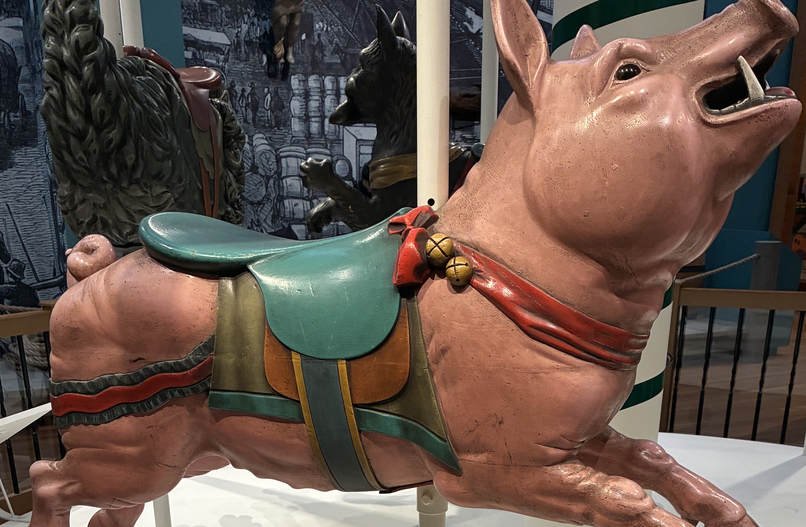

# Carousel challenge

Input supplied for the research:

The supplied questions were:

1. The image shows the carving in its exhibit in 2026. What city has the museum that houses this exhibit among its combined collections?
2. As of 2020–2026, name the three other carousel animals displayed alongside this pig. Include all three animals.
3. There are currently functional carousels with animals designed or made by the sculptor from Q1. What park has the largest number of original carousel pieces made by that artist?
4. Before its 20th-century restoration, the carousel in that park had a horse that rumors say was used to count the rotations. What sculpture is trailing behind it in the same row?
5. The carousel had a pig in storage, but it was fixed and added back by 1980. Using historic documentation of the placement of the carvings, at what location was the stored pig added? Assume the chariots remain in the same locations. Choose from `a-r` or `A-R`.
6. An expert appraised the carousel and prepared the cost estimates for the 1970s refurbishment. In 1975, how much was the cost in USD for one animal estimated to be, including stripping, sanding, painting, and rebuilding?

The original supplied list refers to Q1 and Q4 from an apparently longer challenge. The later user clarification calls the stored-pig question **Q6** and the price question **Q7**. The latest review follows those clarified numbers. The artist identification question itself was not supplied separately.

The requested deliverables were answers with evidence, thorough reproducible search instructions, and a review handoff. See [RESEARCH.md](RESEARCH.md), [REVIEW.md](REVIEW.md), and [REVIEW_HANDOFF.md](REVIEW_HANDOFF.md).
